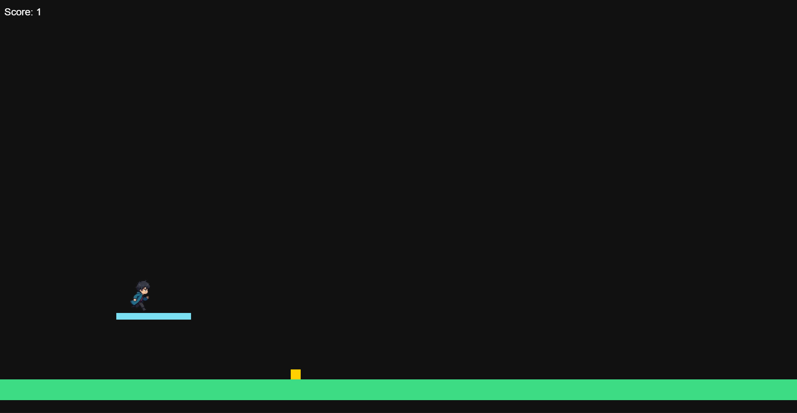
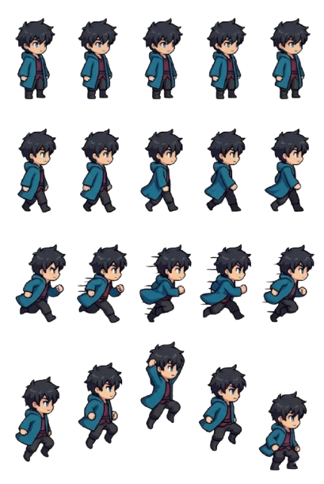

<h1>🍓 BerryJs</h1>


<p>>A lightweight 2d game engine for browser</p>
<p>No dependencies. Just a little project I built myself.</p>



## Quick Start
```bash
npm create berryjs my-game
cd my-game
npm install
npm run dev
```

Open http://localhost:5173/ Or Open the Url shown in the terminal

**Demo controls:** `Enter` to start, arrow keys to move, `Shift` to run, `Space` to jump, `Esc` to return to the menu.


Your Project Will look like this:

```
my-game/
  index.html
  main.js              # creates the game and starts it
  scenes/
    MenuScene.js       # title screen
    GameScene.js       # the playable level, edit this to make your game
  public/
    assets/
      player-sheet.png
```


## Manual Install (Not Recc By PiyusX 😁💩)
 
```bash
npm install berryjs
```

Use Vite to run BerryJS in your project. which resolved `import... from "berryjs" fro you.

## Hello World

A player that moves with the arrow keys and jumps with Space:

```js
import { Game, Scene, Actor } from "berryjs"
 
class Player extends Actor {
    update(dt) {
        const keyboard = this.game.keyboard
 
        if (keyboard.isDown("ArrowRight")) this.x += 200 * dt
        if (keyboard.isDown("ArrowLeft")) this.x -= 200 * dt
 
        if (this.grounded && keyboard.isDown("Space")) {
            this.vy = -420
            this.grounded = false
        }
    }
}
 
class MyScene extends Scene {
    start() {
        const floorY = this.game.height - 80
 
        const player = new Player(80, floorY - 100, 40, 40)
        player.color = "#ff4d6d"
        player.gravity = 800
 
        const floor = new Actor(0, floorY, 2000, 50)
        floor.solid = true
        floor.color = "#3ddc84"
 
        this.add(player)
        this.add(floor)
    }
}
 
const game = new Game({ width: 800, height: 600 })
game.setScene(new MyScene())
game.start()
```

## Features

- **Game loop** with delta time
- **Scenes** with start, update, draw and end methods
- **Actors** with movement, gravity and sprites
- **Collisions** with solid and one-way platforms
- **Camera** with actor following and world bounds
- **Sprite animations** with horizontal flipping
- **Keyboard input** using key codes
- **Sound** with overlapping playback

  
## Core Concepts

### Game
 
```js
const game = new Game({
    width: 800,            // canvas width (default 800)
    height: 600,           // canvas height (default 600)
    fullscreen: false,     
    parent: document.body,
    background: "#111111"
})
 
game.setScene(scene)
game.start()
```
 
### Scenes
 
Create screens (menu, level, game over) by extending `Scene`:
 
```js
class MenuScene extends Scene {
    start() {}                 
        if (this.game.keyboard.isDown("Enter")) {
            this.game.setScene(this.game.gameScene)
        }
    }
    draw(ctx) {              
        ctx.fillStyle = "white"
        ctx.fillText("Press Enter", 100, 100)
    }
    end() {}                 
}
```

### Actors
 
Everything in the world is `Actor`. Override `update(dt)` for behavior and `onOverlap(other)` to react to touching other actors.
 
```js
const coin = new Actor(400, 300, 24, 24)
coin.tag = "coin"
coin.color = "#ffd000"
```

Collecting a coin, for example:
 
```js
class Player extends Actor {
    onOverlap(other) {
        if (other.tag !== "coin") return
 
        this.score += 1
        this.game.remove(other)
    }
}
```

### Sprites
 
Load a sprite sheet where each row is an animation:
 
```js
import { Sprite, loadImage } from "berryjs"
 
const image = await loadImage("/assets/player-sheet.png")
const sprite = new Sprite(image, frameWidth, frameHeight)
 
player.setSprite(sprite)
sprite.setAnimation(1, 5)   // row 1, 5 frames
```

Here is the Example BluePrint


### Camera
 
```js
this.game.camera.follow(player)
this.game.camera.setBounds(0, 0, worldWidth, worldHeight)
this.game.camera.follow(null)   // stop following
```
 
### Keyboard
 
```js
this.game.keyboard.isDown("ArrowLeft")
this.game.keyboard.isDown("Space")
this.game.keyboard.isDown("KeyW")
this.game.keyboard.isDown("ShiftLeft")
```
  
### Sound
 
```js
import { Sound } from "berryjs"
 
const jump = new Sound("/assets/jump.wav")
jump.play()
```

## API Overview

| Export | Description |
|---|---|
| `Game` | Game setup and loop |
| `Scene` | Game screens and levels |
| `Actor` | Game objects |
| `Sprite` | Sprite animations |
| `Camera` | Camera movement and bounds |
| `Collision` | Collision detection |
| `Sound` | Sound playback |
| `loadImage(src)` | Loads an image |

Common `Game` methods: `setScene()`, `start()`, `stop()`, `add()`, `remove()` and `clear()`.


## Development
 
```bash
git clone <https://github.com/PiyuSX/BerryJs>
cd berryjs
npm install
npm run dev     # start the example with Vite
npm test        # run the test (Personally i pass all 😋)
```

## Author
 
Made by [Piyush](https://piyushrajbanshi.com.np).
 
## Contributing
 
Issues and pull reqs are welcome.
 
## License
 
MIT


